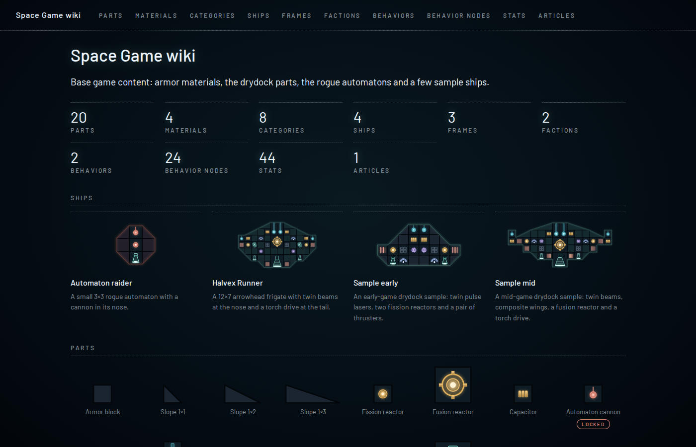
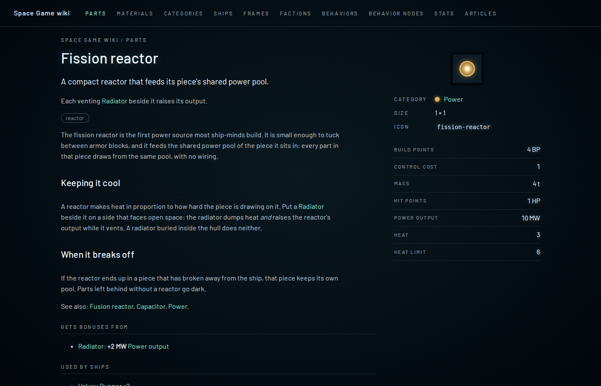
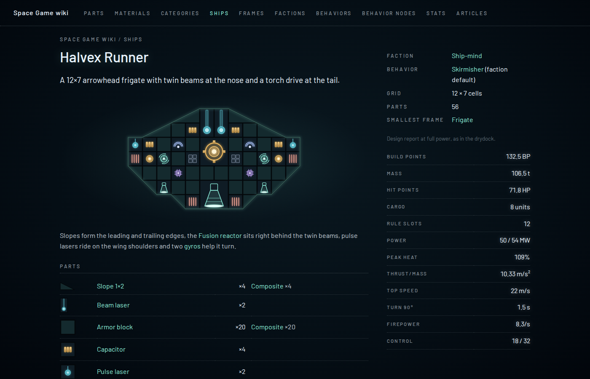

# The wiki

A static website generated from the content packs: every part, material, category, ship, frame, faction,
behavior, behavior node, stat, research family, research node, start and free article gets a page, cross-linked
both ways. Written 13 Oct 2026 (ADR-0032, Proposed); the career kinds (families, research, starts, salvage
blocks, locked frames) were added the same day. Code: `crates/content-tool/src/wiki/`. It is a developer and
modder wiki for now: locked content is shown and marked.



## Generate and view

```
cargo run -p content-tool -- wiki /tmp/space-wiki                          # base pack
cargo run -p content-tool -- wiki /tmp/space-wiki content/base ../my-mod   # base plus a mod, in load order
python3 -m http.server 8090 --bind 0.0.0.0 -d /tmp/space-wiki              # then http://10.77.9.2:8090
```

- Packs are given like for `validate` and `export-json`: directories in load order, default `content/base`. The
  packs are loaded and validated first (errors stop it, warnings are printed), then the site is written. It takes
  a few tens of milliseconds.
- The output is plain HTML, one stylesheet and two font files, no JavaScript: open `index.html` from disk or serve
  the folder with any static server. Do not commit the output; generate it when needed.
- The output directory must be new, empty, or an earlier wiki. Each run writes `.wiki-files` (the list of files it
  made); the next run removes pages that no longer exist (an entry deleted from a pack) and touches nothing else. A
  non-empty directory without that list is refused.
- The output is deterministic: the same packs give byte-identical files (paths sorted, entries in load order, no
  dates), so two generations diff cleanly.

## What it shows

| Page | Contents |
|---|---|
| `index.html` | Pack description, counts per kind, ship cards, the part palette (category order), articles, the loaded packs. |
| `parts.html` … `pages.html` | One list per kind, named like the kind's pack directory (`behavior_nodes.html`; free articles are `pages.html`). Parts are grouped by category, research nodes by family, behavior nodes by role, stats into part and ship stats; starts are cards with their ship. |
| `part/<id>.html` | The part on its style-2a tile (hull parts in every armor material), category, size, power tier, weapon family and delivery, shield absorption, icon key; stat lines as the drydock shows them (hull parts: a table per armor material); adjacency bonuses it grants (with the parts they reach) and gets; ships that use it; "Unlocked by" (the research nodes that unlock it); "Salvage": research data and materials an intact part gives and the fragment a destroyed one leaves (hull parts: per armour material, by hull area). |
| `material/<id>.html` | Swatch, armor tone, per-cell stats, the hull parts made from it with their stats in it, ships that use it; "Unlocked by"; armour materials: salvage per cell of hull area; materials that salvage gives or research costs (programmable matter): the parts that give it and the research that costs it. |
| `ship/<id>.html` | The layout drawn from the blueprint, faction, effective behavior, grid, smallest frame it fits, the starts that begin with it; the drydock's numbers from the sim's design report (full power, full use, `SimConfig::default()`); its parts with counts and materials. |
| `category/`, `faction/`, `frame/` | Colour or glow, parts of the category, ships of the faction (and its default behavior), ships whose grid fits the frame (and, for a locked frame, "Unlocked by"). |
| `family/<id>.html` | Research family: colour, its research nodes (kind, summary, unlocks, cost), nodes of other trees that cost its data, and the parts and armour materials whose salvage gives its data (per part, per cell of hull). |
| `research/<id>.html` | Research node: family, kind (`NewPart` … `Alien`, as words), cost (data per family and materials, linked); what it unlocks (parts, materials and frames with their pictures, mind capacity as text); the nodes it requires and the nodes that require it. |
| `start/<id>.html` | How a new game begins: the ship drawn like on its ship page (and linked), the mind capacity with the research that adds to it, the open voyages as plain ids (the voyage kind does not exist yet, so they have no pages), and the parts, materials and frames a new game has (everything not locked). |
| `behavior/<id>.html` | The rules as in the editor's text view, every node linked in its role's colour; the nodes it uses; factions using it as default; ships flying it. |
| `behavior_node/<id>.html` | Role, value type, how it is written, the parameters (type, default, range, choices), the Rhai script; behaviors that use it. |
| `stat/<id>.html` | Unit, precision, which way is better; every part, material, bonus and ship with that stat and its value. |
| `page/<id>.html` | A free article from `wiki/page/<id>.md`. |

Every entry page also shows the summary, description, lore and tags, the prose file if there is one, "Mentioned
on" (entries whose texts or prose link here) and a collapsed "Data" block (id, link syntax, defining file, prose
file, text keys).

- **All text comes from the content**: names, summaries, stat labels, units and precision (`stats.ron`), node and
  parameter names. Values are formatted by `Content::stat_line`, exactly like the drydock. Only the page chrome
  (headings such as "Used by ships", fact labels, "Locked") is the tool's own English, like the game's UI strings.
- **Locked** parts, materials and frames (`locked: true`, GDR-0054, GDR-0063) appear everywhere with a coral
  "Locked" badge; their pages say which research unlocks them, or that none does yet.
- **Drawings are vector**: icons are the pack's SVGs, inlined once per page as `<symbol>`s (ids prefixed with
  `icon-<key>-`, because all icons use the same gradient ids); ships and parts are SVG built from
  `data::geometry` (tiles, slopes, seams, icons turned and mirrored like the placements, the hull glow of the main
  piece in the faction's colour). Colours come from `art/tokens.json`, embedded at build time.
- **Look**: the game's UI (`docs/style-guide.md`): the dark radial backdrop, Barlow (copied from
  `crates/game/assets/fonts` with its licence), uppercase tracked grey labels, white numbers with a slight glow,
  teal links, dotted rules instead of boxes.

## Prose files

Long-form text lives next to the data and is never embedded in the game:

```
content/base/wiki/part/fission_reactor.md   # extra text on the part's page, under its description
content/base/wiki/page/drydock_rules.md     # a free article; its first "# " line is the title
```

`wiki/<kind>/<id>.md` works for every kind (`stat`, `category`, `faction`, `material`, `part`, `frame`, `ship`,
`behavior_node`, `behavior`, `family`, `research`, `start`); validation rejects prose for entries that do not
exist. Mods add or replace prose by path like any other file.

The Markdown is a small subset, rendered by the tool itself:

- `#` to `######` headings (they start at `<h2>`: the page has its own title; a leading `# ` line is the title of a
  free article and is left out of the text), paragraphs, `-`/`*` and `1.` lists (one level; indented lines continue
  an item), `>` quotes, `---` rules, fenced code blocks.
- Inline: `[[kind:id]]` and `[[kind:id|label]]` links (checked by validation, rendered as hyperlinks), `` `code` ``,
  `**bold**`, `*italic*`. The same inline marks work in every content text (summaries, descriptions, lore).
- Anything else shows as text: raw HTML is escaped, Markdown links `[text](url)` and tables are not supported.
- Keep numbers out of prose (content-model rule); link to the stat or the part instead.

## Tests

`cargo test -p content-tool` (`crates/content-tool/src/wiki/tests.rs` and the unit tests next to the code):
the base pack's wiki builds without warnings; every content item has a page and nothing else is written;
every `href`, `url(...)` and `#fragment` resolves to a generated file and element; two runs are byte-identical;
cross-links exist both ways (also for families, research nodes, starts, salvage and unlocks); locked parts,
materials and frames are marked; drawings use the pack's icons and the faction's glow, no `` or `<script>`
anywhere; a test mod with `<`, `&`, `>` and quotes in every kind of text (a family, a research node and a start
included, and a relabelled stat) is escaped everywhere and shows the mod's stat label; `write` replaces an earlier
wiki and refuses other directories; plus the Markdown subset and the icon id prefixing.

## Not yet

Search (it would need JavaScript), a tag index, translated wikis (wiki prose is English only, ADR-0018), the
drydock's yaw and device-load words on ship pages, pictures of behavior graphs and of research trees, and voyage
pages (they come with the voyage kind; starts show voyage ids as plain text until then).




